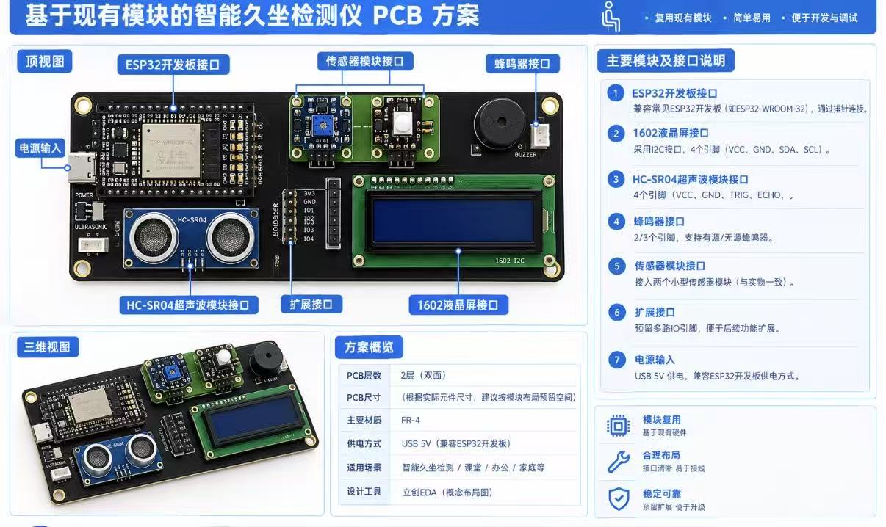
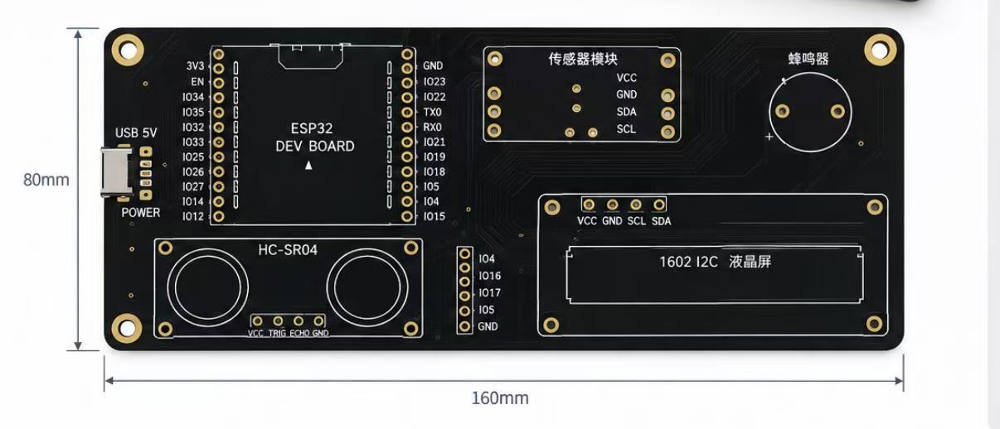

# ESP32-S3 智能久坐检测与语音提醒系统

基于 **ESP32-S3**、**HC-SR04 超声波传感器**、**LCD1602 I2C 液晶屏**、蜂鸣器和 LED 构建的智能久坐检测装置，并融合“小智”语音交互能力。设备能够检测座位前是否有人、记录连续就坐时间，在达到设定时长后进行声光提醒，同时在液晶屏上实时显示计时与距离。

## 项目展示





## 主要功能

- **人员检测**：HC-SR04 持续测量距离，目标距离小于 10 cm 时判定有人就坐。
- **久坐计时**：检测到人员后开始累计就坐时间，并在 LCD1602 上显示 `Time` 和 `Dist`。
- **声光提醒**：当前程序为便于演示，将提醒阈值设为 60 秒；到达阈值后 LED 与蜂鸣器持续提醒 3 秒。
- **离座复位**：连续 6 次未检测到人员后，自动清零计时并关闭提醒。
- **语音交互**：接入“小智”语音系统，首次检测到人员时通过正常唤醒词流程触发问候。
- **模块化硬件**：ESP32 开发板、LCD、超声波传感器、蜂鸣器及传感器模块均采用独立接口，便于装配、调试和扩展。

> 当前的 60 秒阈值用于快速演示。实际使用时，可在 `chuangkebisai_audio_board.cc` 中修改提醒时间。

## 硬件组成

| 模块 | 作用 |
| --- | --- |
| ESP32-S3 开发板 | 主控、Wi-Fi 联网与任务调度 |
| HC-SR04 | 测量人与设备之间的距离 |
| LCD1602（I2C） | 显示连续就坐时间和实时距离 |
| 蜂鸣器 | 久坐声音提醒 |
| LED | 久坐视觉提醒 |
| INMP441 | 语音输入 |
| MAX98357 | I2S 音频输出 |
| 自制 PCB | 集成接口与供电，板框约 160 mm × 80 mm |

PCB 采用双层 FR-4 设计，通过 USB 5V 供电。开发板、显示屏和常用传感器均使用模块化接口，方便更换与二次开发。

## 引脚定义

以下引脚来自当前工程配置：

| 功能 | ESP32-S3 引脚 |
| --- | --- |
| HC-SR04 TRIG | GPIO2 |
| HC-SR04 ECHO | GPIO3 |
| LCD1602 SDA | GPIO8 |
| LCD1602 SCL | GPIO9 |
| LED | GPIO10 |
| 蜂鸣器 | GPIO13 |
| INMP441 SCK | GPIO4 |
| INMP441 WS | GPIO5 |
| INMP441 SD | GPIO6 |
| MAX98357 LRC | GPIO40 |
| MAX98357 BCLK | GPIO41 |
| MAX98357 DIN | GPIO42 |

LCD1602 默认 I2C 地址为 `0x27`，总线频率为 50 kHz。如模块地址不同，请修改 `main/lcd1602.h` 中的 `LCD1602_ADDR`。

## 工作流程

1. 系统启动并初始化 Wi-Fi、音频、LCD、超声波传感器、LED 与蜂鸣器。
2. HC-SR04 每秒进行一次距离检测。
3. 检测距离小于 10 cm 时，系统判定有人就坐，计时从 0 开始。
4. LCD 第一行显示已就坐时间，第二行显示当前距离。
5. 首次检测到人员且设备处于空闲状态时，触发“小智”问候。
6. 就坐时间达到 60 秒后，蜂鸣器与 LED 提醒 3 秒。
7. 连续 6 次未检测到人员时，判定离座并复位计时。

## 软件环境

- ESP-IDF 5.5.4
- CMake / Ninja
- PowerShell（仓库提供构建脚本）
- 目标芯片：ESP32-S3
- Flash：8 MB

## 编译与烧录

项目脚本位于 `chuangkebisai/xiaozhi.ps1`。使用前请先安装 ESP-IDF，并根据本机环境修改脚本中的工具链路径与 `IDF_PATH`。

```powershell
cd chuangkebisai

# 编译
.\xiaozhi.ps1 build

# 烧录（按实际串口修改）
.\xiaozhi.ps1 flash -Port COM5

# 查看串口日志
.\xiaozhi.ps1 monitor -Port COM5

# 烧录后直接打开串口监视器
.\xiaozhi.ps1 flash-monitor -Port COM5
```

首次使用“小智”语音功能时，请根据设备提示完成 Wi-Fi 配网及服务端配置。

## 目录结构

```text
ESP32-/
└─ chuangkebisai/
   ├─ main/
   │  ├─ hc_sr04.c / .h          # 超声波测距
   │  ├─ lcd1602.c / .h          # LCD1602 驱动
   │  ├─ buzzer.c / .h           # 蜂鸣器驱动
   │  ├─ led.c / .h              # LED 驱动
   │  └─ xiaozhi-esp32-2.2.4/    # 小智主体工程及自定义开发板
   ├─ partitions/                 # 分区表
   └─ xiaozhi.ps1                # 编译、烧录与监视脚本
```

久坐检测的核心业务逻辑位于：

```text
chuangkebisai/main/xiaozhi-esp32-2.2.4/main/boards/
└─ chuangkebisai-audio/chuangkebisai_audio_board.cc
```

## 参数调整

可以在 `chuangkebisai_audio_board.cc` 中按需要修改以下参数：

- `distance < 10.0f`：人员检测距离阈值。
- `elapsed_seconds >= 60`：久坐提醒时间，正式使用时可改为例如 `1800`（30 分钟）。
- `kMissedSamplesBeforeReset = 6`：判定离座前允许的连续测距失败次数。
- `alarm_seconds = 3`：声光提醒持续时间。

## 注意事项

- HC-SR04 的 ECHO 通常为 5V 电平；连接 ESP32-S3 时建议使用分压或电平转换，避免损坏 GPIO。
- 上电前请再次核对电源极性、模块电压和所有引脚连接。
- 若 LCD 无显示，请检查 I2C 地址、SDA/SCL 接线以及背光设置。
- 超声波测距会受到安装角度、反射面和周围障碍物影响，建议在实际座椅环境中重新标定距离阈值。

## 致谢

语音交互部分基于仓库内的 `xiaozhi-esp32` 工程进行适配与扩展。
